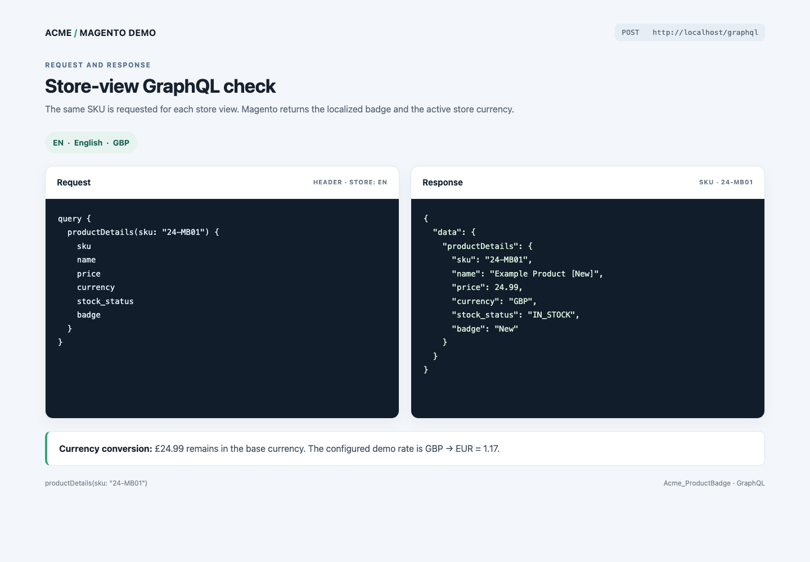
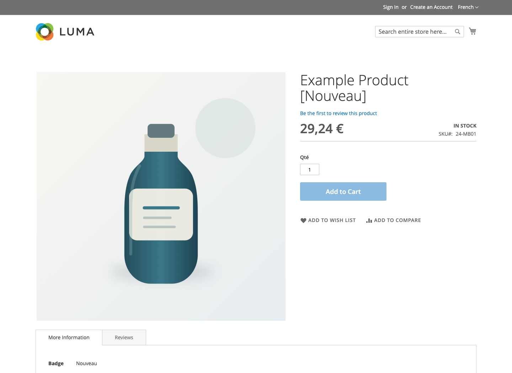
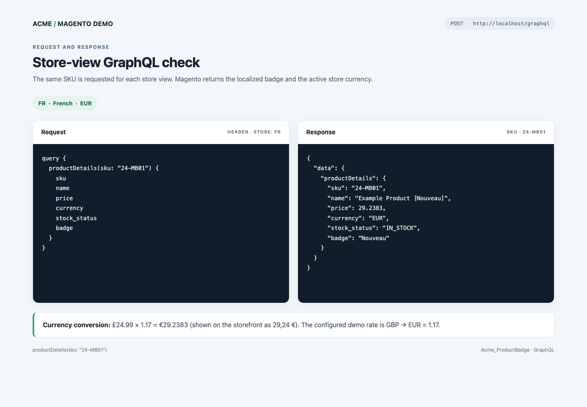
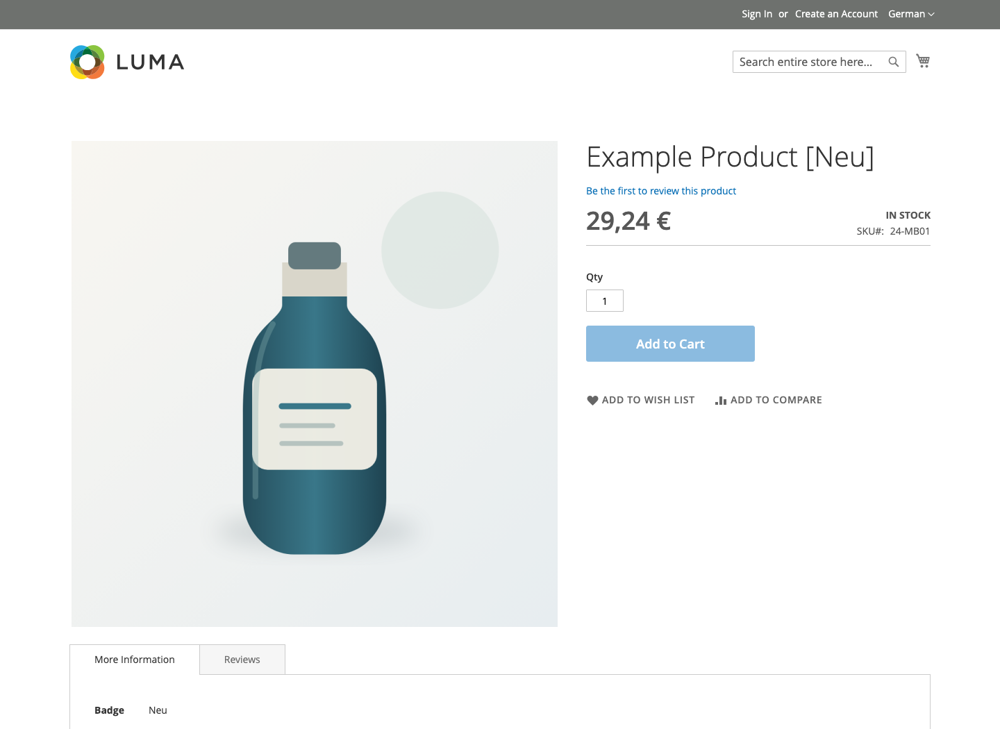

# Acme Product Badge

This Magento module adds a store-view aware Badge product attribute and the `productDetails` GraphQL query.

## Install

Copy this module to `app/code/Acme/ProductBadge`, then run:

```sh
bin/magento setup:upgrade
bin/magento cache:flush
```

In the product edit page, the Badge dropdown is under Product Details. It contains New, Best Seller, and Sale. Option labels are translated for store views with codes `en`, `fr`, and `de`.

## Demo setup

The included demo scripts create those store views, configure their locale and currency, and create a simple product with SKU `24-MB01`. They also add the included sample product image. Copy `dev/codex-task` into the Magento project root before running them. With this Docker setup, use:

```sh
bin/cli php dev/codex-task/create_store_views.php
bin/cli bin/magento setup:upgrade
bin/cli php dev/codex-task/create_demo_product.php
bin/cli bin/magento cache:flush
```

For a non-Docker install, run the scripts with `php dev/codex-task/create_store_views.php` and `php dev/codex-task/create_demo_product.php` from the Magento project root.

The demo uses English/GBP, French/EUR, and German/EUR. It sets GBP as the base currency and uses a sample GBP-to-EUR rate of 1.17. Set a current exchange rate before using real prices.

## Query

Send the desired store view in the `Store` request header:

```graphql
query {
  productDetails(sku: "24-MB01") {
    sku
    name
    price
    currency
    stock_status
    badge
  }
}
```

For SKU `24-MB01`, the name and badge are `Example Product [New]` / `New` in English, `Example Product [Nouveau]` / `Nouveau` in French, and `Example Product [Neu]` / `Neu` in German. The price is converted to the selected store currency. An unknown SKU returns `productDetails: null`.

## Store-view results

The demo product costs GBP 24.99. French and German use EUR with a sample GBP-to-EUR rate of 1.17, so the GraphQL price is EUR 29.2383 and the storefront displays 29,24 € after rounding.

| Store header | Language | Currency | Product name | Storefront price | Badge |
| --- | --- | --- | --- | ---: | --- |
| `en` | English | GBP | Example Product [New] | £24.99 | New |
| `fr` | French | EUR | Example Product [Nouveau] | 29,24 € | Nouveau |
| `de` | German | EUR | Example Product [Neu] | 29,24 € | Neu |

## Store-view screenshots

The product page keeps the same SKU and stock status while the selected store view changes its currency formatting and badge translation. Each GraphQL image shows the same query with the matching `Store` request header and live response from Magento.

### English · `Store: en` · GBP




### French · `Store: fr` · EUR





### German · `Store: de` · EUR




## Assumptions

- The requested product name formatting applies anywhere Magento reads a product name, including product listings and GraphQL.
- Stock status comes from Magento's product salability check.
- The sample rate is for local demonstration only.

